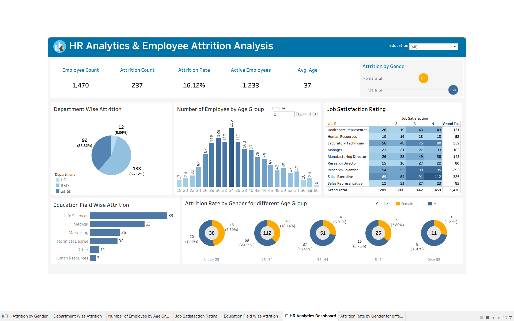

# HR Analytics & Employee Attrition Analysis Dashboard | Tableau

## 🌟 Project Overview

The HR Analytics & Employee Attrition Analysis Dashboard is a Tableau-based data analytics project designed to analyze employee attrition, workforce demographics, department-wise employee turnover, and job satisfaction.

The dashboard transforms raw employee data into an interactive visual report, helping users monitor workforce distribution, identify attrition patterns, understand employee demographics, and evaluate employee satisfaction across different job roles and departments.

The dashboard provides insights into employee count, attrition count, attrition rate, active employees, gender distribution, age groups, education fields, and job satisfaction ratings.

An interactive Education filter allows users to explore employee attrition across different educational backgrounds and understand workforce patterns more effectively.

## 📊 Business Problem

Employee attrition is an important challenge for organizations because high employee turnover can affect workforce stability, recruitment costs, productivity, and overall business performance.

HR teams need to understand why employees leave, which departments experience higher attrition, how employee demographics influence turnover patterns, and whether job satisfaction varies across different roles.

Analyzing raw employee data manually makes it difficult to identify attrition trends, compare employee groups, and understand the factors associated with employee turnover.

This project addresses these challenges by presenting important HR metrics and interactive visualizations in a single Tableau dashboard, supporting better workforce analysis and data-driven HR decisions.

## 🎯 Key Objectives

1. Monitor overall workforce performance using key performance indicators (KPIs).
2. Analyze total employee count, attrition count, and attrition rate.
3. Understand the distribution of active and former employees.
4. Analyze employee attrition across different departments.
5. Explore employee distribution across different age groups.
6. Compare attrition patterns between male and female employees.
7. Identify education fields contributing to higher employee attrition.
8. Analyze job satisfaction ratings across different job roles.
9. Understand attrition distribution across gender and age groups.
10. Enable interactive analysis using Tableau filters.

## 📁 Data Source

**Source:** https://docs.google.com/spreadsheets/d/1-1Ldoe-DwZTL77tdMtRgZAIzeAzs0jh3/edit?gid=2089618187#gid=2089618187

**Sheet Name:** HR data

## 📝 Tools and Technologies

1. **Tableau Public / Tableau Desktop** - Dashboard development, data visualization, and interactive reporting.
2. **Microsoft Excel** - Source dataset containing employee information and HR metrics.
3. **Calculated Fields** - Creating attrition metrics, employee counts, and percentage calculations.
4. **Data Visualization** - Pie charts, bar charts, histograms, heatmaps, and donut charts.
5. **Age Group Analysis** - Creating age bins to analyze employee distribution across different age groups.
6. **Tableau Filters** - Interactive filtering by Education Field.
7. **Dashboard Design & Formatting** - Organizing KPIs and visualizations into an interactive HR analytics dashboard.

## 🚀 Key Performance Indicators (KPIs)

The dashboard includes five primary KPIs:

1. **Employee Count:** Total number of employees included in the dataset.
2. **Attrition Count:** Total number of employees who have left the organization.
3. **Attrition Rate:** Percentage of employees who left the organization out of the total employee count.
4. **Active Employees:** Total number of employees currently working in the organization.
5. **Age:** Represents the employee age metric displayed on the dashboard.

**Overall Workforce Summary:**

- Total Employees: 1,470
- Attrition Count: 237
- Attrition Rate: 16.12%
- Active Employees: 1,233

## 📈 Dashboard Visualizations

The HR Analytics Dashboard provides an interactive overview of employee attrition, workforce demographics, departmental performance, and job satisfaction.

**Key Visualizations:**

1. **Attrition by Gender:** Compares the number of employees who left the organization across male and female categories to understand gender-wise attrition distribution.

2. **Department Wise Attrition:** Uses a pie chart to display employee attrition across HR, R&D, and Sales departments, helping identify departments with higher employee turnover.

3. **Number of Employees by Age Group:** Uses a histogram to display employee distribution across different age groups, helping understand workforce demographics and age-wise employee concentration.

4. **Job Satisfaction Rating:** Uses a highlight table to compare job satisfaction ratings across different job roles. The visualization helps identify satisfaction patterns across employees in different positions.

5. **Education Field Wise Attrition:** Compares employee attrition across education fields such as Life Sciences, Medical, Marketing, Technical Degree, Other, and Human Resources.

6. **Attrition Distribution by Gender Across Age Groups:** Uses donut charts to compare male and female attrition counts across different age groups, helping understand demographic patterns in employee turnover.

**Interactive Filters:**

1. **Education:** Filter the dashboard based on employees' educational backgrounds.

2. **Age Bin Size:** Adjust the age group interval in the employee age distribution chart.

## ✅ Conclusion

The HR Analytics & Employee Attrition Analysis Dashboard provides an interactive overview of workforce demographics, employee attrition, departmental distribution, and job satisfaction.

By combining KPI monitoring, department-wise attrition analysis, age-group distribution, education field analysis, and job satisfaction comparisons, the dashboard helps users understand employee turnover from multiple perspectives.

The project demonstrates how Tableau can transform raw HR data into meaningful visual insights and support data-driven human resource management decisions.
